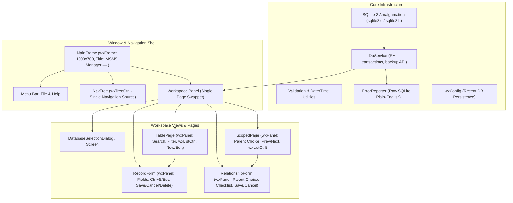

# MSMS Manager — Step-by-Step Implementation Plan

This implementation plan translates [design.md](file:///home/synapse/Projects/msms-db-manager/design.md) and [tech.md](file:///home/synapse/Projects/msms-db-manager/database/tech.md) into concrete, sequential development steps. It strictly adheres to the specified architecture (C++17, wxWidgets 3.2, embedded SQLite amalgamation, CMake) and avoids all time references or duration estimates.

---

## Architecture & Component Breakdown



---

## Phase 1: Project Setup, Build System & Core Database Engine

### Step 1.1: Build System Configuration & Vendoring
- Initialize repository metadata files per §5 and §9 of [tech.md](file:///home/synapse/Projects/msms-db-manager/database/tech.md):
  - `LICENSE`: GNU General Public License v3.0 or later (`GPL-3.0-or-later`).
  - `README.md`: Project description, build/run instructions, SmartScreen warning note, and SHA-256 verification instructions.
  - `.gitignore`: Standard rules for C++, CMake build artifacts, SQLite database files (`*.db`), and IDE cache.
- Initialize the directory structure matching §5 of [tech.md](file:///home/synapse/Projects/msms-db-manager/database/tech.md):
  - `src/db/`, `src/ui/`, `src/forms/`, `src/util/`, `tests/`, `packaging/`
- Set up root `CMakeLists.txt` (CMake ≥ 3.27, C++17):
  - Configure wxWidgets 3.2 target discovery via `find_package(wxWidgets COMPONENTS Core Base REQUIRED)`.
  - Add fallback logic using `FetchContent` or `ExternalProject` if wxWidgets is not found on the host system.
  - Setup Catch2 (v3.x) via `FetchContent` for automated unit testing.
- Vendor SQLite amalgamation:
  - Add official `sqlite3.c` and `sqlite3.h` (≥ 3.45.x) into `src/db/`.
  - Create a CMake target `sqlite3_lib` with `-DSQLITE_THREADSAFE=1` (redundant feature flags such as `-DSQLITE_ENABLE_JSON1` omitted since JSON1 is built-in by default from SQLite 3.38+).
- Provide `CMakePresets.json` with presets:
  - `debug` (assertions enabled, verbose logging)
  - `release` (`-O2`, assertions disabled, optimized)
  - `ci-windows`, `ci-linux`
- Create code quality configuration files:
  - `.clang-format` (LLVM base, 4-space indent, 100-character line limit)
  - `.clang-tidy` (checks: `bugprone-*`, `modernize-*`, `performance-*`)

### Step 1.2: Database Service Implementation (`DbService`)
- Implement `DbService` encapsulating SQLite operations:
  - **Connection Management:** Open database file, execute `PRAGMA foreign_keys = ON;` on every single connection, and verify via `PRAGMA foreign_keys;`.
  - **Schema Initialization:** Initialize new database using [schema.sql](file:///home/synapse/Projects/msms-db-manager/database/schema.sql) (embed SQL as C++ raw string literal or string resource).
  - **Compatibility Check:** Validate schema on opening existing database (check for presence of all 9 tables: `members`, `meetings`, `meeting_attendance`, `projects`, `project_members`, `committee_appointments`, `activities`, `external_competitions`, `competition_participants` and expected columns).
  - **Integrity Check:** Execute `PRAGMA integrity_check`.
  - **Prepared Statements & Query Execution:** Safe RAII wrappers for `sqlite3_stmt*` execution, parameter binding, row extraction, handling string conversion between `wxString` and UTF-8.
  - **Transaction Support:** Explicit `Begin()`, `Commit()`, and `Rollback()` methods for atomic multi-row operations.
  - **Online Backup API:** Implement `BackupTo(const wxString& destPath)` using `sqlite3_backup_init`, `sqlite3_backup_step`, `sqlite3_backup_finish`.
  - **Safe Atomic Restore:** Implement `RestoreFrom(const wxString& backupPath)`:
    1. Validate `backupPath` with `integrity_check` and table compatibility check.
    2. Write safety copy of current active database with timestamp suffix.
    3. Atomically replace database using temporary file and atomic rename.
    4. Reopen connection and verify `PRAGMA foreign_keys = ON`.

### Step 1.3: Error Reporter & Foreign Key Explanation (`ErrorReporter`)
- Implement `ErrorReporter` class:
  - Capture raw `sqlite3_errmsg(db)`.
  - Intercept SQLite error codes (specifically `SQLITE_CONSTRAINT_FOREIGNKEY`, `SQLITE_CONSTRAINT_UNIQUE`, `SQLITE_CONSTRAINT_CHECK`).
  - Generate plain-language explanations for foreign-key restriction failures, identifying the exact blocking relationship:
    - `meeting_attendance` blocks member or meeting deletion.
    - `project_members` blocks member or project deletion.
    - `committee_appointments` blocks member deletion.
    - `competition_participants` blocks member or competition deletion.

### Step 1.4: Unit Tests for Core Database Infrastructure
- Implement Catch2 test cases in `tests/test_db_service.cpp`:
  - Verify `PRAGMA foreign_keys = ON` is always enabled.
  - Verify table schema compatibility checks accept valid databases and reject altered/incomplete schemas.
  - Verify database creation from `schema.sql` and seeding from [seed.sql](file:///home/synapse/Projects/msms-db-manager/database/seed.sql).
  - Verify SQLite online backup produces a bit-for-bit coherent, valid database.
  - Verify atomic restore safety copy creation and rollback behavior on corrupted input files.
  - Verify foreign-key `RESTRICT` prevention on deletion of referenced records.

---

## Phase 2: Application Shell, Navigation & Database Selection

### Step 2.1: Main Application Entry & Config Persistence
- Implement `App` (`wxApp`) in `src/main.cpp`:
  - Initialize wxWidgets application lifecycle.
  - Read remembered database path using `wxFileConfig` / `wxConfig`.
  - If valid database exists at stored path, load database and initialize `MainFrame` landing on **All Members**.
  - If no database path is remembered or file fails validation, display `DatabaseSelectionDialog`.

### Step 2.2: Database Selection Dialog / Screen (`DatabaseSelectionDialog`)
- Implement startup database selection view:
  - Options: **Open Existing Database** and **Create New Database**.
  - "Open Existing": Standard `wxFileDialog`, invokes `DbService::CheckCompatibility()`.
  - "Create New": Standard `wxFileDialog`, warns before overwriting existing files, runs `DbService::CreateNew()`.
  - On successful open/create, save path in configuration, close dialog, and transition to `MainFrame`.

### Step 2.3: Main Window Shell (`MainFrame`)
- Create `MainFrame` (derived from `wxFrame`):
  - Window defaults: size ~1000×700, minimum size ~800×500.
  - Title bar format: strictly **`MSMS Manager — <database filename>`** updated whenever database path changes.
  - Layout: `wxBoxSizer` (horizontal) containing:
    - Left panel: collapsible `wxTreeCtrl` navigation tree.
    - Right panel: workspace panel swapping active child view.
  - No bottom bar, no status bar, no tabs.
- Setup Menu Bar:
  - **File:** Open Database…, Create New Database…, Save Backup…, Restore Backup…, Exit (`Ctrl+Q`).
  - **Help:** About (displays modal dialog with GPL-3.0-or-later info, purpose, version).

### Step 2.4: Navigation Tree Structure (`wxTreeCtrl`)
- Populate navigation tree with exact hierarchy and item names:
  ```text
  Members
    All Members                         (table)
    New / Edit Member                   (form)
  Meetings
    All Meetings                        (table)
    Attendees                           (scoped table)
    New / Edit Meeting                  (form)
    Attendance Register                 (relationship form)
  Projects
    All Projects                        (table)
    Project Teams                       (scoped table)
    New / Edit Project                  (form)
    New / Edit Project Members          (relationship form)
  Committee
    All Appointments                    (table)
    Current Committee                   (table)
    New / Edit Appointment              (form)
  Activities
    All Activities                      (table)
    New / Edit Activity                 (form)
  External Competitions
    All Competitions                    (table)
    Competition Teams                   (scoped table)
    New / Edit Competitions             (form)
    New / Edit Competition Team Assignments (relationship form)
  ```
- Implement navigation controller:
  - Tree selection is the exclusive mechanism to change workspace pages.
  - Intercept page changes to check if the current active form is dirty:
    - If dirty, show unsaved changes prompt (**Save / Discard / Cancel**).
  - Clicking a form item in the tree opens a clean/blank form in create mode.

---

## Phase 3: Table Page Component & Record Table Views

### Step 3.1: Generic Table Page Component (`TablePage`)
- Implement reusable `TablePage` (`wxPanel`):
  - Top control bar:
    - `wxSearchCtrl` / text box for real-time searching across all displayed columns.
    - Optional `wxChoice` filter control (only shown when page defines filter options; completely hidden otherwise).
    - `wxButton` **New** (always enabled; switches workspace to blank form).
    - `wxButton` **Edit** (disabled until row is selected; switches workspace to populated form for selected record ID).
  - Data table:
    - `wxListCtrl` in report mode (or `wxGrid` configured as read-only).
    - Single row selection mode.
    - Column headers fixed; column-click sorting disabled.
    - Primary key IDs hidden from user display.
  - Dynamic filtering & sorting:
    - In-memory or query-level search filtering across all text columns.
    - Predefined fixed order applied per table specification.

### Step 3.2: Implement All 7 Record Table Views
Instantiate `TablePage` for each required record view:
1. **All Members:**
   - Columns: `Name`, `Class`, `Phone`, `Email`, `Status`, `Join Date`.
   - Filter dropdown: `All`, `Active`, `Former`.
   - Fixed sort order: Name ascending.
2. **All Meetings:**
   - Columns: `Title`, `Type`, `Date`, `Start`, `End`, `Location`.
   - Filter dropdown: `All`, `AGM`, `EGM`, `ECM`.
   - Fixed sort order: Date descending (blanks last).
3. **All Projects:**
   - Columns: `Title`, `Status`, `Start`, `Target End`, `Actual End`.
   - Filter dropdown: `All`, `Planned`, `Ongoing`, `Completed`, `Cancelled`.
   - Fixed sort order: Title ascending.
4. **All Appointments:**
   - Columns: `Office`, `Member`, `Start Date`, `End Date`.
   - Filter dropdown: None (control absent).
   - Fixed sort order: Start Date descending.
5. **Current Committee:**
   - Columns: `Office`, `Member`, `Start Date`, `End Date`.
   - Filter dropdown: None.
   - Query filter: `start_date <= date('now', 'localtime') AND (end_date IS NULL OR end_date >= date('now', 'localtime'))`.
   - Fixed sort order: Office ascending.
6. **All Activities:**
   - Columns: `Title`, `Type`, `Date`, `Start`, `End`, `Location`.
   - Filter dropdown: `All` + distinct types queried dynamically from `activities`.
   - Fixed sort order: Date descending (blanks last).
7. **All Competitions:**
   - Columns: `Title`, `Year`.
   - Filter dropdown: None.
   - Fixed sort order: Title ascending.

---

## Phase 4: Scoped Relationship Page Component

### Step 4.1: Generic Scoped Page Component (`ScopedPage`)
- Implement reusable `ScopedPage` (`wxPanel`):
  - Top navigation bar:
    - Label and parent dropdown (`wxChoice`): lists parents by human-readable name without showing database IDs.
    - Stepper buttons: `‹` (Previous) and `›` (Next) to cycle through parents.
    - Selected parent's label prominently shown.
  - Content table:
    - Read-only grid displaying members assigned to the selected parent.
    - Includes `member_id` column as specified in §6.3 of [design.md](file:///home/synapse/Projects/msms-db-manager/design.md).
    - Grid is strictly read-only; no inline editing.

### Step 4.2: Implement the 3 Scoped Views
Instantiate `ScopedPage` for the relationship views, defining empty states when no parent records exist:
1. **Attendees (Meetings):**
   - Parent dropdown format: `"<title> — <meeting_date>"`.
   - Columns: `member_id`, `name`, `phone`, `email`.
   - Empty state: If no meetings exist, display clear placeholder message (e.g. *"No meetings yet — create one to see attendees"*) and disable stepper controls.
   - Query joins `meeting_attendance` with `members`.
2. **Project Teams (Projects):**
   - Parent dropdown format: `"<title>"`.
   - Columns: `member_id`, `name`, `phone`, `email`, `role`.
   - Empty state: If no projects exist, display clear placeholder message (e.g. *"No projects yet — create one to see project teams"*) and disable stepper controls.
   - Query joins `project_members` with `members`.
3. **Competition Teams (Competitions):**
   - Parent dropdown format: `"<title> — <year>"`.
   - Columns: `member_id`, `name`, `role`.
   - Empty state: If no competitions exist, display clear placeholder message (e.g. *"No competitions yet — create one to see competition teams"*) and disable stepper controls.
   - Query joins `competition_participants` with `members`.

---

## Phase 5: Record Form Component & Validation Engine

### Step 5.1: Form Validation Engine (`Validation`)
- Implement field and cross-field validators in `src/util/Validation.h`:
  - **Date/Time Formats:** `YYYY-MM-DD` and 24-hour `HH:MM`.
  - **Date Ordering:**
    - Meeting & Activity: End Time ≥ Start Time (when both provided).
    - Project: Start Date ≤ Target End Date; Start Date ≤ Actual End Date (when both provided).
    - Committee Appointment: End Date ≥ Start Date (when both provided).
  - **Required Field Checks:** Marked with asterisk (*).
  - **Duplicate Detection:**
    - Member duplicate name check: Non-blocking warning dialog (names are not required to be unique).
    - Competition duplicate `(title, year)` check: Schema constraint collision handled and reported cleanly.

### Step 5.2: Base Record Form Component (`RecordForm`)
- Implement reusable base `RecordForm` (`wxPanel`):
  - Action buttons:
    - **Save:** Validates; on success saves to database and returns to parent table view refreshed. On error, keeps form open with user input preserved and displays error message.
    - **Cancel:** If dirty, prompt unsaved changes; returns to parent table.
    - **Delete:** Enabled only in Edit mode. Prompts confirmation dialog. On confirmation, deletes record and returns to parent table. Catches `SQLITE_CONSTRAINT_FOREIGNKEY` and shows plain-language relationship explanation.
  - Keyboard shortcuts: `Ctrl+S` to Save, `Esc` to Cancel.
  - Dirty state tracking: Monitors changes across `wxTextCtrl`, `wxChoice`, `wxDatePickerCtrl`, and `wxTimePickerCtrl`.
  - Clean field layout using `wxFlexGridSizer`.

### Step 5.3: Implement the 6 Record Forms
1. **New / Edit Member:**
   - Fields: Name*, Class, Phone, Email, Status (`Active` / `Former`, default `Active`), Join Date*.
   - Returns to: `All Members`.
2. **New / Edit Meeting:**
   - Fields: Title*, Type* (`AGM`, `EGM`, `ECM`), Date, Start Time, End Time, Location.
   - Returns to: `All Meetings`.
3. **New / Edit Project:**
   - Fields: Title*, Status* (`Planned`, `Ongoing`, `Completed`, `Cancelled`), Start Date, Target End Date, Actual End Date.
   - Returns to: `All Projects`.
4. **New / Edit Appointment:**
   - Fields: Office*, Member* (active members dropdown; in edit mode, keeps existing former member if assigned), Start Date*, End Date.
   - Primary key is `(start_date, office)`: disable Office and Start Date during edit mode to preserve identity integrity per §11.4 of [design.md](file:///home/synapse/Projects/msms-db-manager/design.md).
   - Returns to: `All Appointments`.
5. **New / Edit Activity:**
   - Fields: Title*, Type* (editable combo with existing types), Date, Start Time, End Time, Location.
   - Returns to: `All Activities`.
6. **New / Edit Competitions:**
   - Fields: Title*, Year*.
   - Returns to: `All Competitions`.

---

## Phase 6: Relationship Form Component & Multi-Row Editing

### Step 6.1: Relationship Form Component (`RelationshipForm`)
- Implement reusable `RelationshipForm` (`wxPanel`):
  - Top: Parent selector dropdown (`wxChoice`).
    - **Empty Parent State:** If no parent records exist (e.g., no meetings, projects, or competitions), show a disabled dropdown with placeholder text (e.g. *"No meetings available"*), and disable checklist and Save button.
    - **Dirty Tracking on Parent Switch:** If the user attempts to change the parent dropdown after making unsaved edits to the checklist or roles, intercept the event and trigger the standard unsaved changes prompt (**Save / Discard / Cancel**) before switching parents.
  - Middle: Scrolled checklist view (`wxScrolledWindow` / custom check list with extra columns):
    - **Composition Rule:**
      - All members with status `Active` are always listed.
      - Members with status `Former` are listed **only** if currently assigned to this parent record, marked clearly with label suffix `"(Former)"`.
      - Currently assigned members are pre-checked.
    - **Additional per-row controls:**
      - Project members: `wxChoice` for Role (`Member`, `Lead`).
      - Competition participants: `wxTextCtrl` for Role (free text).
      - Meeting attendance: simple checkbox.
  - Bottom: **Cancel** and **Save** buttons.
  - **Save Execution:**
    - Execute within a single database transaction (`BEGIN IMMEDIATE` ... `COMMIT`).
    - Remove unchecked previously-assigned records.
    - Insert newly checked members with their roles.
    - Update role modifications for continuing members.
    - On success: return to parent table refreshed.
    - On error: rollback transaction, leave form open with values intact.

### Step 6.2: Implement the 3 Relationship Forms
1. **Attendance Register:**
   - Parent: Meeting dropdown (`title — date`).
   - Checklist: Members.
   - Returns to: `All Meetings`.
2. **New / Edit Project Members:**
   - Parent: Project dropdown (`title`).
   - Checklist: Members + Role dropdown (`Member` / `Lead`).
   - Returns to: `All Projects`.
3. **New / Edit Competition Team Assignments:**
   - Parent: Competition dropdown (`title — year`).
   - Checklist: Members + Role text field.
   - Returns to: `All Competitions`.

---

## Phase 7: Backup, Restore & Safety Workflows

### Step 7.1: Online Backup Flow
- Triggered from `File → Save Backup…`:
  - Open file save dialog.
  - Call `DbService::BackupTo(destinationPath)` using SQLite online backup API.
  - Show modal confirmation only after the online copy is completely finished and verified.
  - Never report success prematurely.

### Step 7.2: Safe Atomic Restore Flow
- Triggered from `File → Restore Backup…`:
  - Display explicit modal confirmation explaining the action.
  - Open file dialog to choose backup file.
  - Run integrity verification (`PRAGMA integrity_check`) and table compatibility validation on candidate file.
  - Create a timestamped safety copy of the current active database file located directly **alongside it** in the same directory (e.g. `<working_dir>/<working_db_filename>.backup.<timestamp>`).
  - Close active SQLite connection.
  - Perform atomic replace (copy to temporary file, then atomic rename over working database).
  - If any failure occurs during verification or replace, abort immediately leaving the working database intact.
  - Re-establish database connection, verify `PRAGMA foreign_keys = ON`, refresh current workspace, and land on **All Members**.

---

## Phase 8: Dialogs, Dirty Tracking & Final Polish

### Step 8.1: Prompt Dialogs & Navigation Safeguards
- Implement confirmation prompts:
  - **Unsaved Changes Prompt:** Triggered on tree navigation, File menu actions, or application exit while form is dirty. Options: **Save / Discard / Cancel**.
  - **Delete Confirmation:** Standard `wxMessageDialog` with explicit confirmation prompt.
  - **File Overwrite Confirmation:** Explicit warning dialog before creating database over an existing file.
  - **Restore Confirmation:** Explicit warning dialog before replacing active database.
- Application close handler (`wxEVT_CLOSE_WINDOW`):
  - Check dirty state of active form; prompt user before quitting.

### Step 8.2: About Dialog (`Help → About`)
- Implement About box using `wxAboutBox`:
  - Name: **MSMS Manager**
  - Licence: **GPL-3.0-or-later**
  - Description: Offline desktop application for managing MSMS membership and society records.

---

## Phase 9: CI Pipeline & Release Packaging

### Step 9.1: Continuous Integration (`.github/workflows/build.yml`)
- Create GitHub Actions workflow with 2-platform matrix:
  - **Windows:** `windows-latest` using `vcpkg` for dependencies, MSVC toolchain.
  - **Linux:** Container pinned to **`ubuntu-20.04`** (enforces glibc 2.31 floor).
- Steps:
  1. Install dependencies (`wxWidgets`, `Catch2`, `ccache`, `linuxdeploy`, `linuxdeploy-plugin-gtk`).
  2. Cache wxWidgets and ccache objects.
  3. Configure with CMake preset (`ci-linux` / `ci-windows`).
  4. Build targets.
  5. Run Catch2 test suite.
  6. Advisory job: `clang-format` and `clang-tidy` checks.

### Step 9.2: Windows Packaging (NSIS)
- Write NSIS installer script in `packaging/windows/installer.nsi`:
  - Bundle statically linked release binary `msms-manager.exe`.
  - Output installer: `MSMSManager-<version>-win64.exe`.
  - Include license file and uninstaller.

### Step 9.3: Linux Packaging (AppImage)
- Write AppImage packaging script in `packaging/linux/appimage.sh`:
  - Statically link `wxWidgets` (wxGTK `--disable-shared`) and `sqlite3`.
  - Use `linuxdeploy` with `linuxdeploy-plugin-gtk` to bundle GTK 3 runtimes, GIO modules, schemas, and pixbuf loaders.
  - Exclude glibc (rely on system glibc ≥ 2.31).
  - Output: `MSMSManager-<version>-x86_64.AppImage`.

### Step 9.4: Release Checksum Generation & Cross-Platform Release Verification
- Add SHA-256 generation step to the release workflow to output `SHA256SUMS` alongside the Windows installer and Linux AppImage.
- Define manual release verification checklist per §12.4 and §12.5 of [tech.md](file:///home/synapse/Projects/msms-db-manager/database/tech.md):
  - **Linux AppImage:** Verify execution across target distributions: Debian 11 (glibc 2.31 floor), Ubuntu 20.04, Ubuntu 22.04, Ubuntu 24.04, Fedora 39, and current Arch Linux.
  - **Windows Installer:** Verify installation and launch on Windows 10 (21H2) and Windows 11 (22H2).

---

## Verification & Acceptance Checklist

| Requirement | Verification Step |
|---|---|
| **Foreign Keys Active** | Unit test verifying `PRAGMA foreign_keys = ON` on newly opened connection. |
| **Data Safety on Delete** | Unit test & UI test verifying `ON DELETE RESTRICT` error message names the blocking relation. |
| **Database Integrity** | Unit test executing `PRAGMA integrity_check` on created and restored databases. |
| **Historical Former Members** | Test relationship form ensures former members are only listed if already assigned. |
| **Validation Rules** | Form tests verifying date ordering (`end >= start`) and required fields. |
| **Backup Verification** | Unit test verifying SQLite online backup copies all tables and records without data loss. |
| **Atomic Restore** | Test simulating failure during restore; verify working database is preserved. |
| **Binary Size** | Check release binary meets < 15 MB requirement on Linux and Windows. |
| **Startup Speed** | Verify cold start under 1 second. |
| **Linux Distro Matrix** | Manual release test: AppImage executes on Debian 11, Ubuntu 20.04, 22.04, 24.04, Fedora 39, and Arch Linux (§12.4). |
| **Windows OS Matrix** | Manual release test: NSIS installer executes on Windows 10 21H2 and Windows 11 22H2 (§12.5). |
